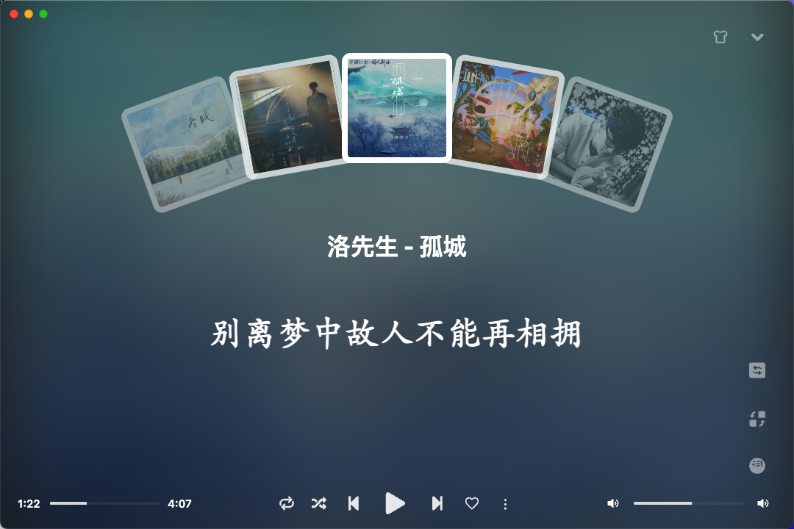
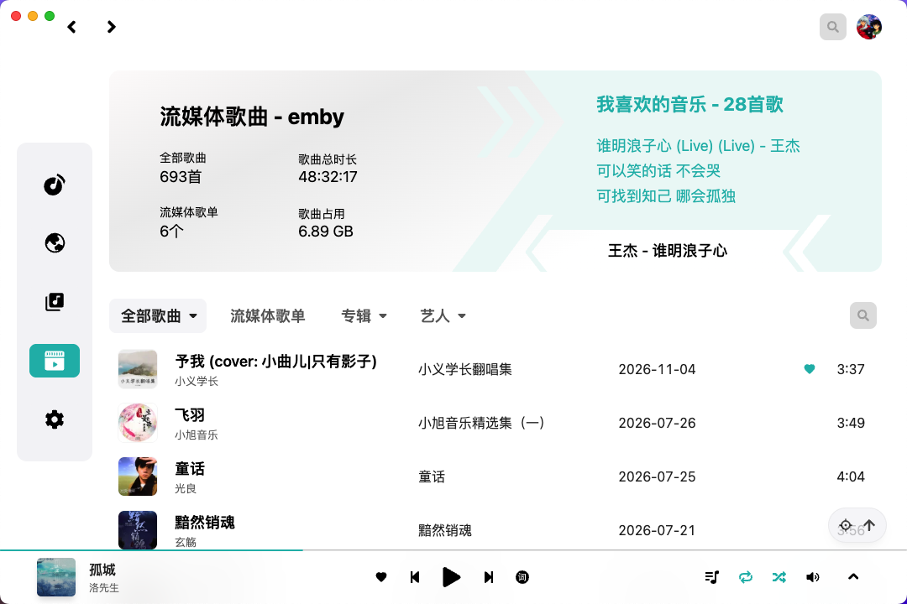
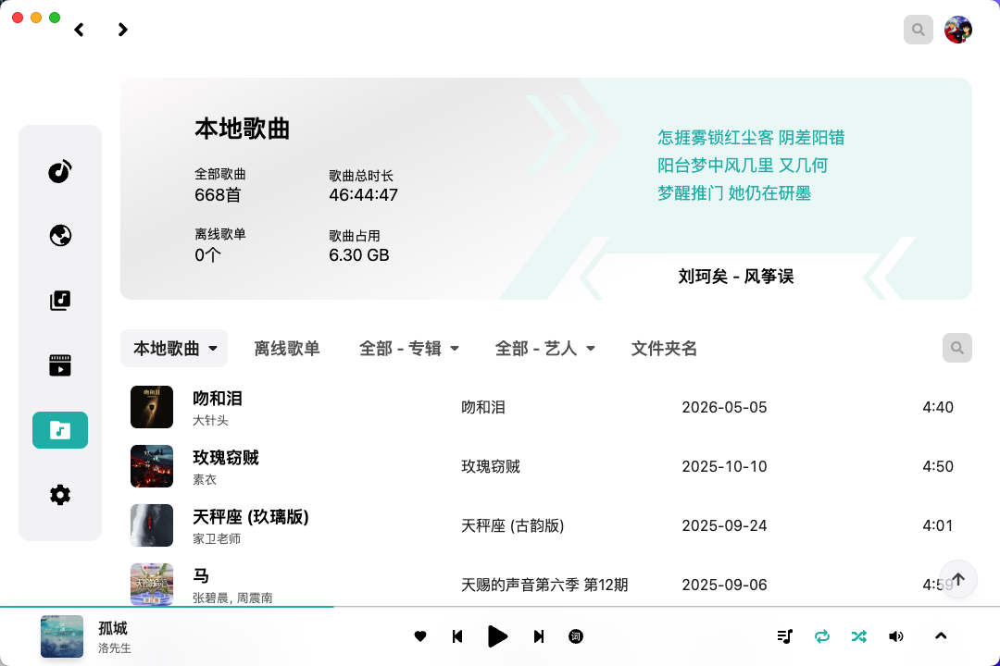
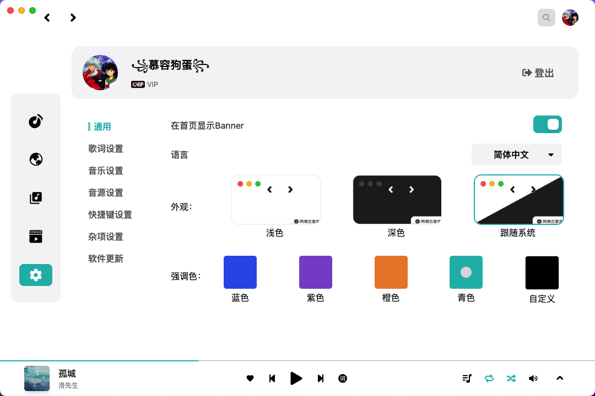
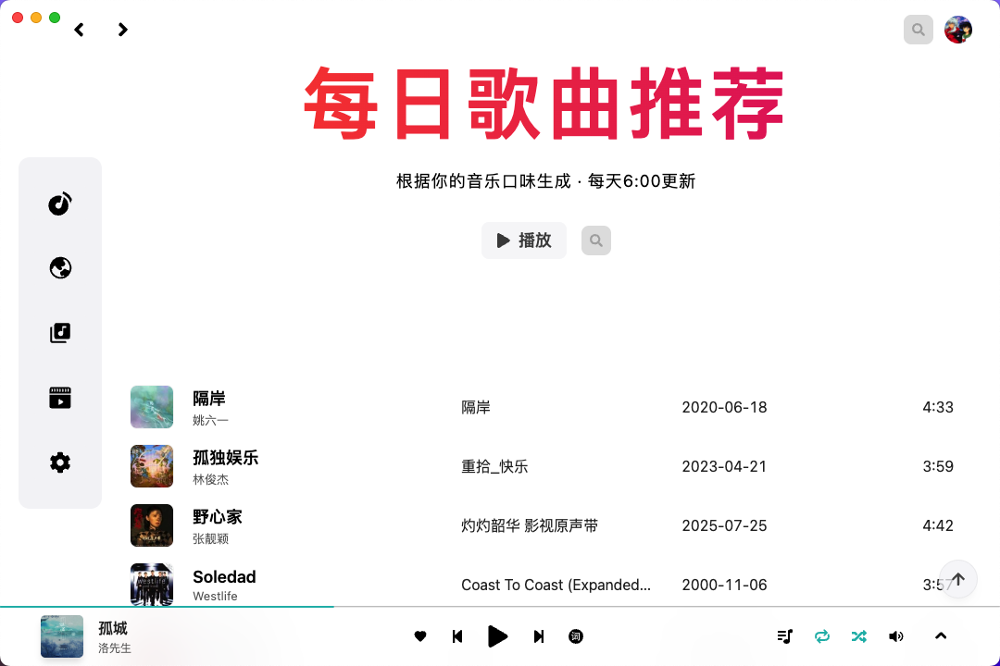
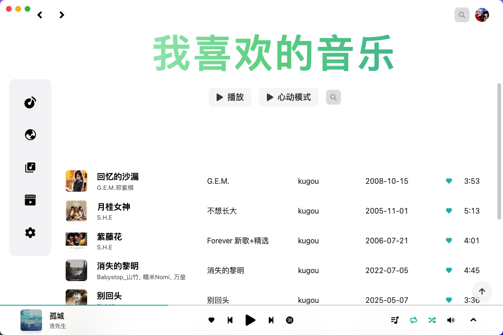
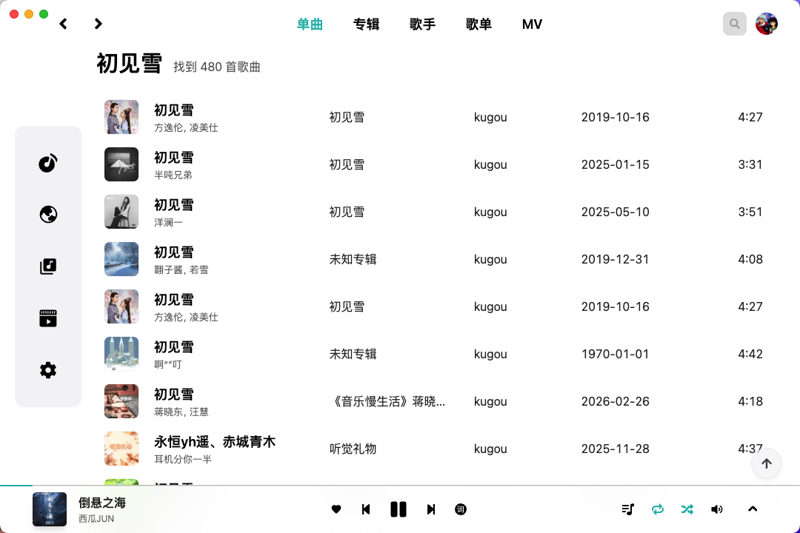
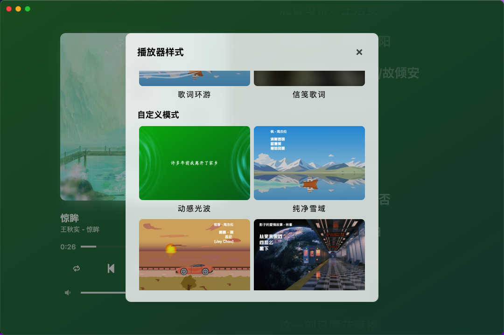
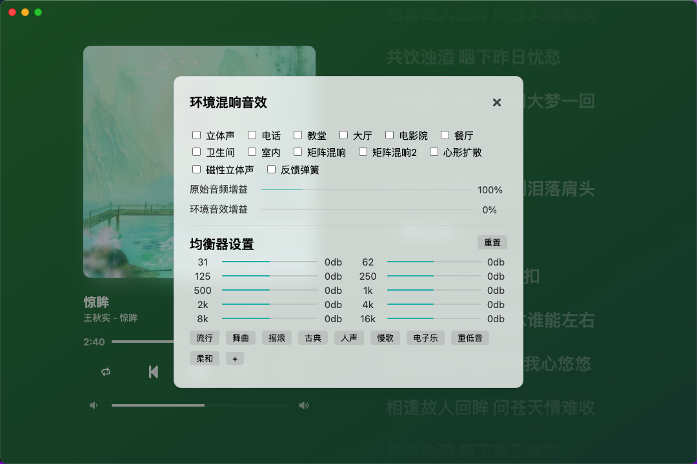

<div align="center">
  <a href="https://github.com/stark81/VutronMusic">
    
  </a>

  <h1>VutronMusic</h1>

  <p><strong>一个播放器，聚合所有来源。</strong></p>
  <p>本地音乐 · 在线平台 · 自建流媒体，在同一个界面里播放</p>

  <p>
    <a href="https://github.com/stark81/VutronMusic/releases">
      
    </a>
    <a href="LICENSE">
      
    </a>
    <a href="https://github.com/stark81/VutronMusic/releases">
      
    </a>
    <a href="https://www.electronjs.org/">
      
    </a>
    <a href="https://vuejs.org/">
      
    </a>
  </p>
</div>

<p align="center">
  <a href="images/home.png"></a>
</p>

## 简介

VutronMusic 是一款基于 **Electron + Vue 3 + TypeScript** 的桌面音乐播放器。

它不只是某一家平台的客户端，而是用插件把三类音乐来源聚合到同一个播放列表：

| 来源类型       | 插件类型  | 例子                      |
| -------------- | --------- | ------------------------- |
| 在线音乐平台   | `library` | 网易云音乐、酷狗音乐      |
| 自建流媒体服务 | `stream`  | Navidrome、Jellyfin、Emby |
| 本地音乐文件   | `local`   | 本地音乐文件夹            |

同一首歌可以同时拥有本地无损文件、在线歌词和社区评论；一次搜索会并列展示多个来源的结果；播放本地歌曲时也会自动匹配在线元数据，让歌词、封面、评论一个都不缺。

> 本项目为个人学习研究项目，界面与交互参考了 YesPlayMusic 等优秀开源作品，详见[致谢](#致谢)。

## 核心特性

### 🧩 插件化架构

- **三类插件**：`library`（在线平台）、`stream`（自建媒体库）、`local`（本地文件），可在设置中分别启用或禁用，并调整搜索时各来源的优先顺序。
- **内置 7 个插件**：网易云音乐、酷狗音乐、Navidrome、Jellyfin、Emby、本地音乐，以及一个演示插件。
- **可扩展**：在「设置 → 插件设置」中导入第三方 `.js` 插件；同一插件还可创建多个实例（例如两台 Navidrome 服务器）。
- **安全隔离**：插件运行在独立的 Worker 线程中，只能访问声明过的域名；返回值统一经过 Zod 校验。
- **能力自适应**：插件通过 `capabilities` 声明自己支持歌词、评论、MV 等能力，界面按钮随能力自动显隐。
- **统一契约**：60 多个插件 API 覆盖搜索、歌单、播放、歌词、评论、MV、登录等能力，核心程序不依赖具体平台实现。

### 📚 本地音乐库

- 多目录扫描，支持 MP3、FLAC、ALAC、M4A、AAC、WAV、AIFF、Opus。
- **三级去重**：MusicBrainz Track ID 一致时归并；或归一化标题 + 专辑 + 艺术家且时长误差 ≤ 2 秒时归并；仅部分匹配则不归并，保留 `(Live)` 等括注。
- **CUE 分轨**：自动识别 CUE 文件并按曲目切分整轨音频。
- 读取内嵌与外挂封面、歌词，支持从 [LDDC](https://github.com/chenmozhijin/LDDC) 下载的逐字歌词格式。
- 可从线上平台补齐封面、歌词与元数据；封面支持内嵌到音频文件或写入同名文件。
- 读取本地歌曲内嵌的 ReplayGain 信息，实现音量平衡。
- 按歌曲、专辑、艺人、文件夹浏览，支持最近添加、离线歌单、歌曲定位与失效记录清理。

### 🎤 歌词系统

- 支持标准 LRC、增强 LRC、YRC、WRC，根据内容特征自动识别并解析为统一的逐行/逐字结构。
- 支持逐字高亮、翻译与罗马音，歌词偏移可按歌曲以 0.5 秒步进微调并持久化。
- 歌词来源包括插件 API、音频内嵌标签、同名 `.lrc` 文件（自动检测编码）以及在线匹配。
- 显示位置覆盖：主窗口歌词页、独立桌面歌词窗口（mini / 完整模式、置顶、锁定透明、鼠标穿透）、macOS 菜单栏原生歌词与 Touch Bar、Linux DBus 状态栏歌词。
- Linux 状态栏歌词可对接 [media-controls](https://github.com/stark81/media-controls)、[dynamic-music-pill](https://extensions.gnome.org/extension/9334/dynamic-music-pill/) 等 GNOME 扩展，或 KDE 的 [vutronmusic-lyrics](https://github.com/cmachsocket/org.kde.plasma.vutronmusic-lyrics) 插件。

### 🎚️ 播放与音效

- 10 段均衡器（31Hz–16kHz），内置多组音效预设并支持保存自定义预设。
- 卷积混响，内置多种空间脉冲响应预设，可分别调节干声与湿声比例。
- 变调与变速（SoundTouchJS）。
- 可调淡入淡出时长、音频输出设备选择。
- 音源替换（UnblockNeteaseMusic），可配置备选音源、优先 FLAC 与第三方 Cookie。
- 在线歌曲自动缓存，可设置缓存目录与容量上限，并支持一键清理。
- 播放队列、随机播放、单曲循环、列表循环与私人 FM。

### 🎨 界面与主题

- 深色 / 浅色 / 跟随系统三种外观，支持自定义强调色。
- 播放页提供经典、创意、信笺三种布局，10 种背景类型，并可从封面提取主色。
- GSAP 歌词入场动画，支持自定义并保存播放主题。
- Windows / Linux 自定义标题栏，以及可自定义的窗口内快捷键。
- 简体中文、繁体中文、English 三种界面语言。

### 🔍 发现与社交

- 推荐歌单、推荐艺人、新专速递、排行榜与每日推荐。
- 搜索歌曲、专辑、艺人、歌单与 MV，多来源结果并列展示。
- 专辑、艺人、MV、歌单详情页，以及个人听歌排行。
- 歌曲评论：查看、点赞、发布与楼层回复。
- 云盘歌曲、收藏与歌单管理，可跨插件统一浏览。

### 🔌 系统集成

- 系统托盘：播放控制、图标颜色设置，以及 macOS 菜单栏 / Linux 状态栏歌词。
- 全局快捷键与窗口快捷键，均可自定义。
- macOS Touch Bar 歌词。
- Linux MPRIS2：媒体键与系统媒体面板控制。
- Windows SMTC / macOS 系统媒体控制。
- Discord Rich Presence：在个人资料中显示当前播放。
- Last.fm Scrobble：OAuth 授权后自动上报播放记录。
- 6K Amuse 兼容服务：供 6K Amuse / OBS 等工具读取当前播放状态。
- 应用内自动更新（electron-updater）。

### 🔐 数据与安全

- 播放数据保存在本地：主进程使用 SQLite（WAL），渲染进程使用 IndexedDB。
- 数据库仅主进程可访问，渲染进程通过 IPC 间接读写。
- 渲染进程被视为不可信输入：窗口加固、IPC 参数校验、文件路径授权、设置项白名单。
- 插件沙箱 + 域名白名单 + Zod 校验，避免第三方插件直接影响核心数据。

## 界面预览

|              歌词页              |          歌词环游           |          信笺歌词           |
| :------------------------------: | :-------------------------: | :-------------------------: |
|  |  |  |

| mac 状态栏歌词 | Windows 状态栏歌词 | Linux 状态栏歌词 |
| :-: | :-: | :-: |
|  |  |  |

|           首页           |            发现             |            音乐库             |
| :----------------------: | :-------------------------: | :---------------------------: |
|  |  |  |

| 流媒体 | 本地音乐 | 设置页 |
| :-: | :-: | :-: |
|  |  |  |

|           每日推荐            |           收藏的音乐           |             歌单              |
| :---------------------------: | :----------------------------: | :---------------------------: |
|  |  |  |

<details>
<summary>更多截图</summary>

|          MV          |               评论               |              搜索               |
| :------------------: | :------------------------------: | :-----------------------------: |
|  |  |  |

| 播放器样式 | 卷积混响 | 系统媒体控制 |
| :-: | :-: | :-: |
|  |  |  |

</details>

## 支持的数据源

| 插件       | 类型      | 说明                                                  |
| ---------- | --------- | ----------------------------------------------------- |
| 网易云音乐 | `library` | 搜索、歌单、每日推荐、排行榜、MV、评论、云盘、私人 FM |
| 酷狗音乐   | `library` | 搜索、歌单、排行榜、MV、评论浏览                      |
| Navidrome  | `stream`  | 通过 Subsonic API 连接自建音乐服务器                  |
| Jellyfin   | `stream`  | 连接自建 Jellyfin 媒体服务器                          |
| Emby       | `stream`  | 连接自建 Emby 媒体服务器                              |
| 本地音乐   | `local`   | 本地文件扫描、CUE 分轨、内嵌/外挂元数据、封面回写     |

此外还内置了一个用于插件开发的演示插件 [`demo.js`](src/public/plugin/demo.js)。第三方插件可在「设置 → 插件设置」中导入，需实现统一的 `PluginAPI` 并返回符合 Zod Schema 的结构，具体可参考[插件文档](docs/src/spec/architecture/plugin/)。

## 下载与安装

前往 [Releases](https://github.com/stark81/VutronMusic/releases) 下载对应平台的安装包：

| 平台    | 安装包                                                                             |
| ------- | ---------------------------------------------------------------------------------- |
| Windows | `.exe` 安装版 / Portable / `.zip`                                                  |
| macOS   | `.dmg`（Intel / Apple Silicon）                                                    |
| Linux   | AppImage / `.deb` / `.rpm`（部分版本提供 snap / flatpak，以 Release 实际产物为准） |

安装后可在「设置 → 软件更新」中检查新版本，应用内置自动更新。

## 快速开始

### 环境要求

| 依赖    | 版本                   |
| ------- | ---------------------- |
| Node.js | >= 22.6.0（推荐 22.x） |
| Yarn    | 1.22.22                |
| Git     | 2.x+                   |

> Linux 构建还需要 `libnss3`、`libgtk-3`、`libasound2` 等系统依赖。若原生模块需要从源码编译，Electron 43 要求 C++20 工具链，macOS 需 Xcode 15+。

### 本地运行

```bash
git clone https://github.com/stark81/VutronMusic.git
cd VutronMusic
yarn install
yarn dev
```

`yarn dev` 会同时启动 Vite 开发服务器与 Electron 主进程。修改 `src/renderer/` 会触发热更新；修改 `src/main/`、`src/preload/` 或 `src/public/plugin/` 后需要重启。

### 常用命令

| 命令                                           | 说明                                  |
| ---------------------------------------------- | ------------------------------------- |
| `yarn dev`                                     | 开发模式（Vite HMR + Electron）       |
| `yarn build`                                   | 生产构建并打包当前平台                |
| `yarn build:mac` / `build:win` / `build:linux` | 指定平台打包                          |
| `yarn build:dir`                               | 只生成未打包的应用目录，便于调试      |
| `yarn lint` / `yarn lint:fix`                  | ESLint 检查 / 自动修复                |
| `yarn format` / `yarn format:fix`              | Prettier 检查 / 格式化                |
| `yarn test`                                    | Playwright 端到端测试（会先执行构建） |
| `cd docs && yarn dev`                          | 本地预览文档站                        |

## 项目结构

```
src/
├── main/                 # Electron 主进程
│   ├── index.ts          # 应用入口、窗口与生命周期
│   ├── IPCs.ts           # IPC 通道
│   ├── db.ts             # SQLite 初始化与迁移
│   ├── dbHelpers.ts      # 数据访问层
│   ├── pluginManager.ts  # 插件生命周期与调用
│   ├── workers/          # 插件执行 / 扫描 / 缓存 / 封面写入
│   ├── appServer/        # Fastify 本地服务（网易云 API / Amuse）
│   ├── tray.ts           # 系统托盘
│   ├── touchBar.ts       # macOS Touch Bar
│   ├── mpris.ts          # Linux MPRIS
│   └── utils/            # 歌词、Last.fm、路径安全等
├── preload/              # contextBridge 与通道白名单
├── renderer/             # Vue 3 前端
│   ├── views/            # 页面视图
│   ├── components/       # 通用组件
│   ├── store/            # Pinia stores
│   ├── locales/          # zh-hans / zh-hant / en
│   └── router/           # Hash 路由
├── types/                # TypeScript 类型与 Zod Schema
└── public/plugin/        # 内置插件
```

## 技术栈

| 领域         | 技术                                                                    |
| ------------ | ----------------------------------------------------------------------- |
| 桌面框架     | Electron 43                                                             |
| 前端         | Vue 3、TypeScript、Vite 5、Pinia、Vue Router 4                          |
| 主进程数据   | better-sqlite3（WAL）                                                   |
| 渲染进程数据 | Dexie（IndexedDB）+ pinia-plugin-persistedstate                         |
| 本地服务     | Fastify 4                                                               |
| 音频         | Web Audio API、SoundTouchJS                                             |
| 数据校验     | Zod                                                                     |
| 插件运行时   | Node.js Worker 线程                                                     |
| 国际化       | vue-i18n（zh-hans / zh-hant / en）                                      |
| 打包         | electron-builder（dmg / nsis / portable / deb / rpm / AppImage / snap） |
| 测试         | Playwright                                                              |

## 架构约束

这些约束是项目长期演进的基础，贡献代码前请先了解：

- **数据库只在主进程**：渲染进程通过 IPC 间接访问，不直接引用 `db.ts`。
- **`sourceContext` 对框架不透明**：它是插件私有数据，框架、其他插件与 UI 都不解析。
- **元数据表只存用户拥有的歌曲**：在线浏览与搜索结果只停留在内存和 Pinia，不落库。
- **插件结果必须过 Zod**：所有返回值都经过 `PluginResultSchema` 校验。
- **渲染进程视为不可信**：新窗口需加固，IPC 入参需校验，文件路径需授权，新增设置项需加入白名单。
- **功能优先用插件实现**：避免为单个平台写特化逻辑，不破坏多源聚合架构。

更完整的规范与检查清单见 [`security.md`](docs/src/spec/architecture/security.md) 与 [`AGENTS.md`](AGENTS.md)。

## 文档

项目文档位于 [`docs/src`](docs/src)，使用 VitePress 构建：

```bash
cd docs
yarn install
yarn dev    # 本地预览
yarn build  # 生产构建
```

| 内容                                   | 位置                                                   |
| -------------------------------------- | ------------------------------------------------------ |
| 产品理念与功能概览                     | [`docs/src/product`](docs/src/product)                 |
| 功能设计（歌词 / 本地库 / 主题 / CUE） | [`docs/src/features`](docs/src/features)               |
| 技术规格（数据库 / 插件 / IPC / 安全） | [`docs/src/spec`](docs/src/spec)                       |
| 架构决策记录（ADR）                    | [`docs/src/adr`](docs/src/adr)                         |
| 排错指南                               | [`docs/src/troubleshooting`](docs/src/troubleshooting) |
| AI / 开发协作约定                      | [`AGENTS.md`](AGENTS.md)                               |

## 常见问题

| 问题 | 处理方式 |
| --- | --- |
| 账号登录失败 | 见 [Wiki - 账号登录](https://github.com/stark81/VutronMusic/wiki/%E8%B4%A6%E5%8F%B7%E7%99%BB%E5%BD%95) |
| Linux 插件、逐字歌词、流媒体配置 | 见 [Wiki](https://github.com/stark81/VutronMusic/wiki/) |
| 扫描不到本地歌曲 | 确认格式受支持（MP3 / FLAC / ALAC / M4A / AAC / WAV / AIFF / Opus），并检查目录读取权限 |
| 音源替换不生效 | 修改「音源设置」后需要清除歌曲缓存再试 |
| 网络 / DNS 异常 | 见 [DNS 排错](docs/src/troubleshooting/dns.md) |
| 启动白屏或原生模块报错 | 确认 Node 为 22.x，删除 `node_modules` 后重新 `yarn install` |

## 贡献

欢迎提交 Issue 与 Pull Request。

- 提交前请先阅读 [`AGENTS.md`](AGENTS.md) 与 [`CODE_OF_CONDUCT.md`](CODE_OF_CONDUCT.md)。
- 新增功能优先考虑插件实现，避免在核心代码中加入平台特化逻辑。
- 提交前运行 `yarn lint` 与 `yarn build:pre`，确保代码风格、类型检查与构建通过。
- 插件开发可参考内置 [`demo.js`](src/public/plugin/demo.js) 与[插件文档](docs/src/spec/architecture/plugin/)。

## 致谢

- [vutron](https://github.com/jooy2/vutron)：项目脚手架。
- [YesPlayMusic](https://github.com/qier222/YesPlayMusic)：界面与功能参考。
- 「方格音乐」：侧边导航栏设计参考。
- [NSMusicS](https://github.com/Super-Badmen-Viper/NSMusicS)：本地音乐统计信息参考。
- [LDDC](https://github.com/chenmozhijin/LDDC)：逐字歌词格式支持。
- [VutronMusic-Android](https://github.com/EBG-bg/VutronMusic-Android): VutronMusic 的非官方Android移植版。
- [NeteaseCloudMusicApiEnhanced](https://github.com/NeteaseCloudMusicApiEnhanced/api-enhanced) 与 [UnblockNeteaseMusic](https://github.com/UnblockNeteaseMusic/server)：网易云 API 与音源替换。
- [media-controls](https://github.com/stark81/media-controls)、[dynamic-music-pill](https://extensions.gnome.org/extension/9334/dynamic-music-pill/)、[vutronmusic-lyrics](https://github.com/cmachsocket/org.kde.plasma.vutronmusic-lyrics)：Linux 状态栏歌词扩展。
- 以及所有提交 Issue、PR 和反馈建议的朋友。

## 免责声明

- 本项目仅供个人学习、研究使用，禁止用于商业及非法用途。
- 本项目不提供任何音频内容。所有音乐、封面、歌词与评论的版权归原平台及版权方所有。
- 使用者需自行确保其音乐来源与使用方式符合当地法律法规及各平台服务条款。
- 因使用第三方插件或音源替换功能产生的一切后果，由使用者自行承担。

## 开源许可

基于 [MIT License](LICENSE) 开源。

## Star 趋势

[](https://www.star-history.com/?repos=stark81%2FVutronMusic&type=date&legend=top-left)
